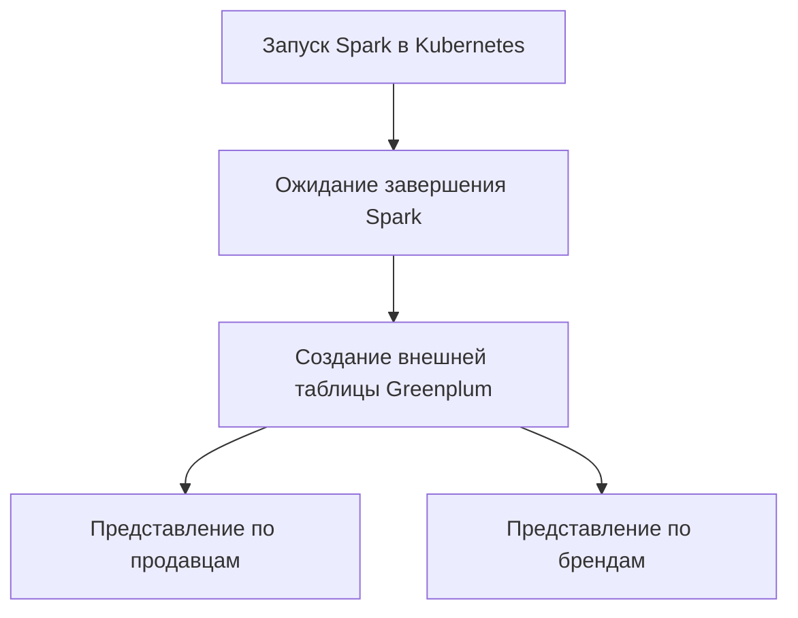

# Витрина данных для маркетплейса KarpovZone

Учебный проект по инженерии данных: обработка карточек товаров в Spark,
хранение результата в S3 и подготовка представлений в Greenplum.
Запуск и последовательность задач организованы через Apache Airflow.

**Автор решения:** Владислав Иванченко.

**Автор учебного кейса и постановки задачи:** ООО «Карпов Курсы»,
[karpov.courses](https://karpov.courses).

## Цель проекта

Подготовить данные о товарах и продавцах для аналитических запросов:
рассчитать дополнительные показатели карточек, подключить обработанные
данные к Greenplum и создать отчёты по продавцам и брендам.

## Задачи

1. Прочитать исходные Parquet-файлы из S3.
2. Рассчитать шесть дополнительных показателей товаров в PySpark.
3. Сохранить обработанные данные в отдельную папку S3.
4. Организовать запуск Spark-приложения в Kubernetes через DAG Airflow.
5. Создать внешнюю таблицу Greenplum для чтения результата через PXF.
6. Подготовить представления по продавцам и брендам.

## Инструменты и подход

| Инструмент | Роль в проекте |
|---|---|
| Python, PySpark | Чтение данных, преобразования и расчёт показателей |
| Apache Spark | Распределённая обработка карточек товаров |
| S3-совместимое хранилище | Исходные и обработанные Parquet-файлы |
| Apache Airflow | Запуск приложения, ожидание результата и выполнение SQL |
| Kubernetes, Spark Operator | Выполнение Spark-приложения в кластере |
| Greenplum, SQL, PXF | Доступ к Parquet в S3 и аналитические представления |
| Git | Хранение исходного кода |

Пайплайн связывает озеро данных и аналитическое хранилище. Spark выполняет
преобразования, а Greenplum обращается к сохранённым файлам через внешнюю
таблицу. Представления рассчитывают агрегаты при выполнении запросов;
отдельные материализованные таблицы с итогами здесь не создаются.

## Источники данных

Используется учебный набор карточек товаров маркетплейса KarpovZone,
размещённый в S3 в формате Parquet.

В скрипте описаны 15 исходных полей: идентификатор и название товара,
категория, бренд, продавец, группа, страна, остатки, заказы, количество
складов, цена, проданные товары, рейтинг, срок продажи и доля выкупа.

Сами данные курса, доступы к хранилищу и параметры учебной инфраструктуры
в репозиторий не включены. Реальные значения заменены заглушками.

## Структура проекта

| Файл | Назначение |
|---|---|
| [karpovzone_data_mart.py](karpovzone_data_mart.py) | DAG Airflow и SQL для внешней таблицы и представлений |
| [spark-job-sellers.py](spark-job-sellers.py) | Spark-сессия, чтение S3, расчёт показателей и запись результата |
| [spark_submit.yaml](spark_submit.yaml) | Описание SparkApplication для Kubernetes |

Файлы находятся в корне репозитория. Такой же путь к Spark-скрипту указан
в `mainApplicationFile` в YAML.

## Как устроен DAG

1. `SparkKubernetesOperator` отправляет SparkApplication в Kubernetes.
2. `SparkKubernetesSensor` получает имя приложения из XCom и ожидает его
   завершения.
3. Первый `SQLExecuteQueryOperator` пересоздаёт внешнюю таблицу
   `seller_items`, указывающую на обработанные Parquet-файлы в S3.
4. Ещё два SQL-оператора создают представления. После создания таблицы
   эти задачи могут выполняться параллельно.

DAG запускается вручную: `schedule_interval=None`, `catchup=False`.

## Рассчитываемые показатели

| Поле | Расчёт |
|---|---|
| `returned_items_count` | `ordered_items_count × (1 − avg_percent_to_sold / 100)` с приведением к целому числу |
| `potential_revenue` | `(availability_items_count + ordered_items_count) × item_price` |
| `total_revenue` | `(goods_sold_count − returned_items_count) × item_price` |
| `avg_daily_sales` | `goods_sold_count / days_on_sell`, если срок продажи больше нуля; иначе `0` |
| `days_to_sold` | `availability_items_count / avg_daily_sales`, если средние продажи больше нуля; иначе `NULL` |
| `item_rate_percent` | `percent_rank()` по рейтингу товара среди всех карточек; значение от `0` до `1` |

Формулы соответствуют реализации учебного кейса. Названия полей сохранены
для совместимости со внешней таблицей Greenplum.

## Представления в Greenplum

### Продавцы — `unreliable_sellers_view`

Для каждого продавца рассчитываются:

- `total_overload_items_count` — сумма доступных остатков;
- `is_unreliable` — признак по правилу кейса: сумма `days_on_sell`
  больше 100 и сумма остатков превышает сумму заказанных товаров.

В правиле используется сумма сроков продажи всех карточек продавца.
Это учебный критерий для отчёта, который требует отдельного согласования
перед применением к реальному бизнесу.

### Бренды — `item_brands_view`

В разрезе бренда, группы и страны рассчитываются:

- суммарная потенциальная выручка;
- суммарная выручка с учётом возвратов;
- количество карточек товаров.

## Подготовка к запуску

Репозиторий содержит код для кластерного окружения. Один запуск Python
на локальном компьютере не разворачивает Airflow, Kubernetes или Greenplum.

Понадобятся Airflow с Kubernetes- и SQL-провайдерами, Kubernetes со Spark
Operator, образ Spark с поддержкой S3, S3-совместимое хранилище и Greenplum
с настроенным PXF-сервером.

В учебном задании использовались провайдеры
`apache-airflow-providers-cncf-kubernetes==7.6.0` и
`apache-airflow-providers-common-sql==1.7.2`. Версию самого Airflow нужно
подбирать совместимой с этими провайдерами.

### 1. Указать параметры S3

В `spark-job-sellers.py` заменить заглушки в `DATA_PATH`, `TARGET_PATH`,
`S3_ENDPOINT_URL`, `S3_REGION`, `S3_ACCESS_KEY` и `S3_SECRET_KEY`.
В публичном репозитории сохранять только заглушки.

### 2. Настроить DAG и Greenplum

В `karpovzone_data_mart.py` указать namespace Kubernetes, идентификаторы
Airflow Connections, существующую схему Greenplum, бакет и префикс S3.
Подключения создать в своём Airflow; для доступа к S3 настроить PXF-сервер.

Папка `TARGET_PATH` в Spark должна совпадать с расположением
`seller_items` в `SELLER_ITEMS_LOCATION` в DAG. Различаются протоколы:
Spark использует `s3a://`, Greenplum — `pxf://`.

### 3. Настроить SparkApplication

В `spark_submit.yaml` заменить адрес Git-репозитория, имя SSH Secret,
service account и примеры tolerations настройками своего кластера.
SSH Secret должен содержать ключ доступа и доверенный `known_hosts`.
Service account должен иметь права, необходимые Spark для работы в кластере.

В YAML указан образ `itayb/spark:3.1.1-hadoop-3.2.0-aws`, а в скрипте —
`hadoop-aws:3.2.0`. Версии согласованы по имени образа; перед запуском
следует проверить фактическую версию Hadoop и состав библиотек внутри него.

### 4. Запустить DAG

Разместить DAG и `spark_submit.yaml` рядом в каталоге DAG-файлов Airflow,
обеспечить доступ driver-контейнера к Git-репозиторию и запустить
`karpovzone_data_mart` вручную. Проверить статусы задач и доступность
представлений в Greenplum.

## Результаты и применение

Реализованы Spark-обработка с шестью дополнительными показателями,
DAG из пяти задач, внешняя таблица с 21 ожидаемым полем и два
аналитических представления.

Результат можно использовать для SQL-анализа остатков, выручки и
ассортимента по брендам, а также для отбора продавцов по правилу кейса.
На практике проект показывает взаимодействие Data Lake, Spark,
оркестратора и аналитического хранилища.

В качестве визуализации приведена схема DAG. Скриншоты выполнения,
графики по данным и численные результаты в эту версию не включены.
Сведения об объёме данных, времени выполнения и бизнес-эффекте
не заявляются.

## Проверки и ограничения

- При подготовке публичной версии проверены синтаксис Python и YAML,
  пути между файлами, ссылки на задачи и соответствие объявленных
  полей внешней таблице. Формулы сопоставлены с исходной реализацией.
- Публичная версия с заглушками не проходила сквозной запуск
  в Kubernetes с S3 и Greenplum. Она требует настройки окружения.
- Объект `schema` в Spark-файле описывает ожидаемые входные поля,
  но не применяется к чтению: фактическая схема берётся из Parquet.
  Типы и порядок полей реальных данных необходимо проверить перед запуском.
- Запись выполняется в режиме `overwrite`. Внешняя таблица
  пересоздаётся с `CASCADE`, после чего заново создаются представления.
  Это не атомарное обновление: во время выполнения отчёты могут быть недоступны.
- `percent_rank()` использует глобальное окно по всем карточкам.
  На больших объёмах этот этап потребует отдельной оценки производительности.
- Контроль качества входных данных, инкрементальная загрузка и
  мониторинг SLA в текущей реализации не предусмотрены.

## Авторство

Проект выполнен в рамках курса Data Engineering от
[karpov.courses](https://karpov.courses).
Учебный кейс и исходная постановка задачи принадлежат
ООО «Карпов Курсы»; решение представлено в учебном портфолио
Владислава Иванченко. Учебные данные и доступы не публикуются.
